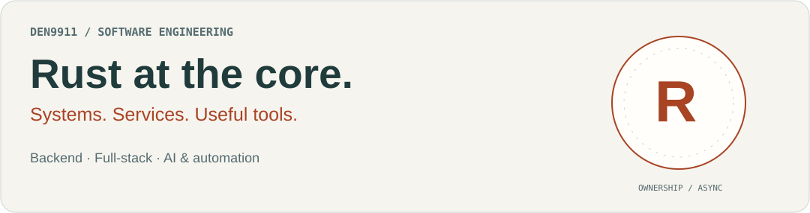
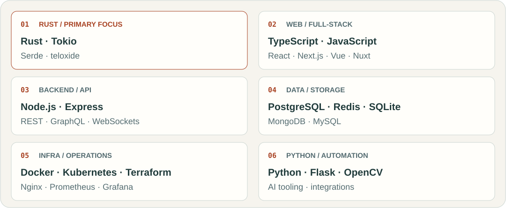

**English** · [Русский](README.ru.md)

<picture>
  <source media="(prefers-color-scheme: dark)" srcset="assets/profile/intro-en-dark.svg">
  
</picture>

## Hi, I’m Denis

I’m a software developer focused on **Rust and backend engineering**. I work across server logic, web interfaces, and automation — from APIs and data storage to the user experience.

### What I work on

- **Rust and async services** — Tokio, Serde, integrations, and bots, with attention to data ownership and predictable behavior.
- **Full-stack development** — TypeScript, JavaScript, React, and Vue; APIs, databases, and real-time interactions.
- **Automation and AI tooling** — Python, service integrations, and tools for everyday tasks.

## Working stack

   &nbsp;
   &nbsp;
   &nbsp;
   &nbsp;

<picture>
  <source media="(prefers-color-scheme: dark)" srcset="assets/profile/stack-en-dark.svg">
  
</picture>

Tools and engineering practices

| Area | Tools and practices |
| --- | --- |
| Quality | Jest · Cypress · pytest · ESLint · Prettier |
| Delivery | Git · GitHub Actions · GitLab CI/CD · Vite · Webpack |
| Architecture | REST/GraphQL contracts · WebSockets · observability |
| Collaboration | Code review · documentation · Mermaid · Figma |
| Other platforms | PHP · Laravel · WordPress |

## My work

See how I put these skills into practice: applications, screenshots, and source code links are collected in my portfolio.

**[Explore my portfolio →](https://den9911.github.io/den9911/docs/)**

## Public code activity

<picture>
  <source media="(prefers-color-scheme: dark)" srcset="assets/profile/activity-en-dark.svg?v=20261102115540604">
  
</picture>

Public default-branch history across 15 repositories, including Rust apps and this profile. Refresh scheduled every six hours; update time appears on the chart. Repository totals include automation and are not personal contribution counts. [Interactive statistics →](https://den9911.github.io/den9911/docs/#activity) [Methodology and updates](profile/README.md).
