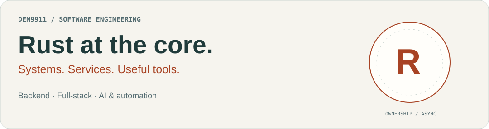
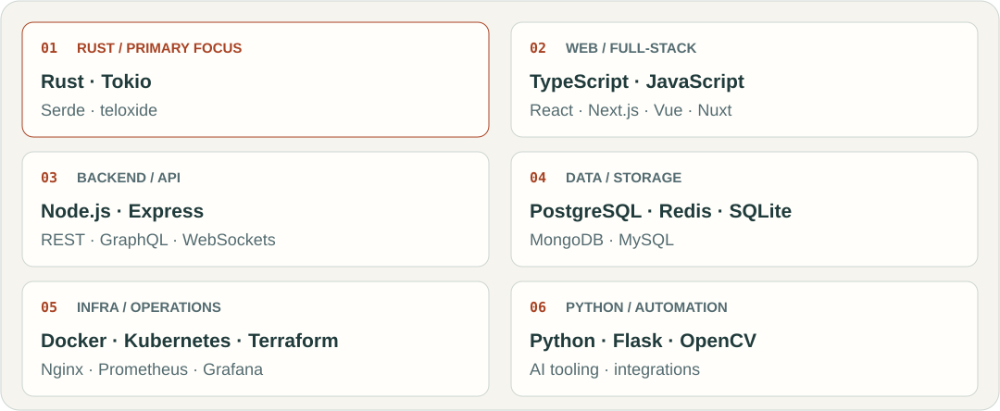
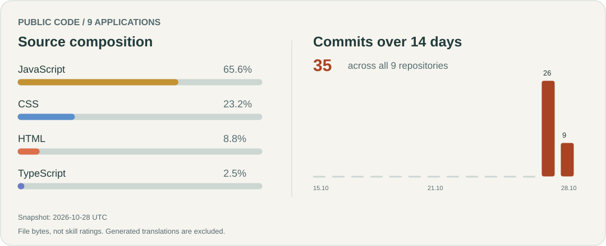

**English** · [Русский](README.ru.md)

<picture>
  <source media="(prefers-color-scheme: dark)" srcset="assets/profile/intro-en-dark.svg">
  
</picture>

I build backend services, web applications, and automation tools. **Rust is my primary focus**: ownership, async programming, and predictable behavior. TypeScript, JavaScript, and Python round out the toolkit for product work.

[Technology](#working-stack) · [Charts](#public-code) · [Projects](#start-here) · [Portfolio](https://den9911.github.io/den9911/docs/)

## Working stack

   &nbsp;
   &nbsp;
   &nbsp;
   &nbsp;

<picture>
  <source media="(prefers-color-scheme: dark)" srcset="assets/profile/stack-en-dark.svg">
  
</picture>

Tools and engineering practices

| Area | Tools and practices |
| --- | --- |
| Quality | Jest · Cypress · pytest · ESLint · Prettier |
| Delivery | Git · GitHub Actions · GitLab CI/CD · Vite · Webpack |
| Architecture | REST/GraphQL contracts · WebSockets · observability |
| Collaboration | Code review · documentation · Mermaid · Figma |
| Other platforms | PHP · Laravel · WordPress |

## Public code

<picture>
  <source media="(prefers-color-scheme: dark)" srcset="assets/profile/activity-en-dark.svg">
  
</picture>

This public collection contains web apps, so its chart reflects web technologies. It measures source size, not my full experience or Rust proficiency. [How the data is measured and refreshed](profile/README.md).

---

### Start here

<table><tr>
<td width="50%" valign="top"><h3> Caption Club</h3>
Write a caption, vote for a favorite, and take home a shareable card.
<a href="https://github.com/den9911/caption-club">Explore the project →</a></td>
<td width="50%" valign="top"><h3> Memory Sketch</h3>
Draw an everyday object from memory, reveal the reference, and save your version.
<a href="https://github.com/den9911/memory-sketch">Explore the project →</a></td>
</tr></table>

### The collection

| | Project | What you can do |
| --- | --- | --- |
|  | [Caption Club](https://github.com/den9911/caption-club) | Write a caption, vote for a favorite, and take home a shareable card. |
|  | [Majority Vote](https://github.com/den9911/majority-vote) | Predict the majority, cast your vote, then see where you stand. |
|  | [Meme Arena](https://github.com/den9911/meme-arena) | Pick the funnier card in head-to-head battles and discover the winners. |
|  | [Memory Sketch](https://github.com/den9911/memory-sketch) | Draw an everyday object from memory, reveal the reference, and save your version. |
|  | [Excuse Bureau](https://github.com/den9911/excuse-bureau) | Turn a small excuse into a playful certificate worth sharing. |
|  | [Crowd Decides](https://github.com/den9911/crowd-decides) | Create a quick poll and let your friends decide together. |
|  | [Pixel Rooms](https://github.com/den9911/pixel-rooms) | Decorate a pixel room and explore a house built by its visitors. |
|  | [Daily Minute](https://github.com/den9911/daily-minute) | Find the odd word, track your time, and share your result. |
|  | [Odd Finds](https://github.com/den9911/odd-finds) | Collect funny signs, strange notices, and things that deserve a second look. |

### Behind the projects

These apps use native HTML, CSS, and JavaScript. Four have an incremental TypeScript migration; seven use Node.js and SQLite for shared data. Memory Sketch and Excuse Bureau run entirely in the browser. Each README includes setup instructions and a Russian translation.

### More to explore

[Motion Playground](experiments/motion-playground/) — a separate collection of CSS interaction experiments.

[Portfolio source](docs/) · [Preview and hosting](SITE.md) · [GitHub](https://github.com/den9911)
