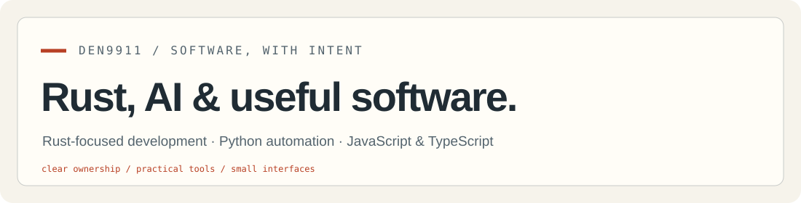

<picture>
  <source media="(prefers-color-scheme: dark)" srcset="assets/header-dark.svg">
  
</picture>

[English](README.md) · [Español](README.es.md) · [Русский](README.ru.md)

# Rust — в основе. Польза — в результате.

Основное направление — Rust: серверные приложения, асинхронные инструменты и предсказуемое поведение программ. Дополняю этот набор работой с AI, автоматизацией на Python, JavaScript и TypeScript.

## Рабочий набор

<p>
  <a href="https://www.rust-lang.org/"></a>
  &nbsp; <a href="https://www.python.org/"></a>
  &nbsp; <a href="https://developer.mozilla.org/en-US/docs/Web/JavaScript"></a>
  &nbsp; <a href="https://www.typescriptlang.org/"></a>
</p>

**Rust** · AI tooling · Python · JavaScript · TypeScript

<details>
<summary>Подробнее о направлении</summary>

Мой основной фокус — Rust: владение, асинхронность и понятное использование ресурсов. Python помогает в автоматизации и интеграциях AI; JavaScript и TypeScript соединяют программы с пользователями.

```rust
const FOCUS: [&str; 3] = ["Rust", "AI tooling", "Useful software"];

fn main() {
    for direction in FOCUS {
        println!("{direction}");
    }
}
```

</details>

## Проекты

Эти приложения используют JavaScript, HTML и CSS. Для общих данных — Node.js и SQLite. Инструкции запуска есть в README проектов.

### Эксперименты для сообщества

| Проект | Подробнее |
| --- | --- |
| [Caption Club](https://github.com/den9911/caption-club) | Ежедневные конкурсы подписей, голоса и открытки. |
| [Majority Vote](https://github.com/den9911/majority-vote) | Необычные вопросы, прогнозы и реальные ответы людей. |
| [Meme Arena](https://github.com/den9911/meme-arena) | Дуэли мемов и публикации с модерацией. |
| [Crowd Decides](https://github.com/den9911/crowd-decides) | Один вопрос, одна ссылка и общее решение. |
| [Pixel Rooms](https://github.com/den9911/pixel-rooms) | Пиксельная комната в доме, который строят вместе. |
| [Daily Minute](https://github.com/den9911/daily-minute) | Общее ежедневное задание на поиск лишнего слова. |
| [Odd Finds](https://github.com/den9911/odd-finds) | Смешные вывески, странные предметы и находки. |

### Творческие инструменты

| Проект | Подробнее |
| --- | --- |
| [Memory Sketch](https://github.com/den9911/memory-sketch) | Тридцать секунд, чтобы нарисовать предмет по памяти. |
| [Excuse Bureau](https://github.com/den9911/excuse-bureau) | Шуточные разрешения, отмазки и дипломы для скачивания. |
| [Motion Playground](experiments/motion-playground/) | Убегающие кнопки, пружинящие карточки и анимации. |

## Интерактивная страница профиля

В [docs/](docs/) — исходники сайта на трёх языках: темы, фильтры проектов и наглядное объяснение владения в Rust. [Запуск и размещение](SITE.md).

[GitHub](https://github.com/den9911) · [Repositories](https://github.com/den9911?tab=repositories)
