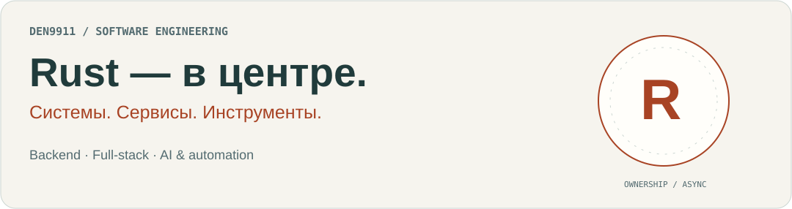
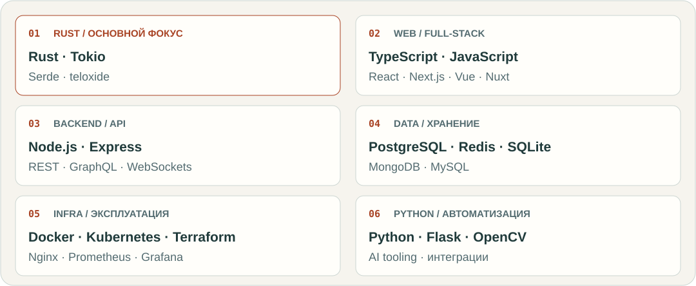
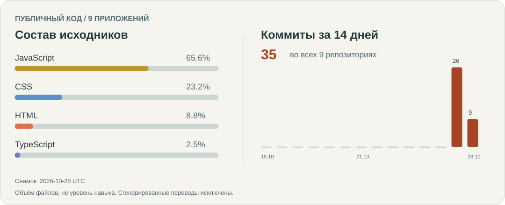

[English](README.md) · **Русский**

<picture>
  <source media="(prefers-color-scheme: dark)" srcset="assets/profile/intro-ru-dark.svg">
  
</picture>

## Привет, я Денис

Я разработчик с фокусом на **Rust и backend**. Работаю с серверной логикой, веб-интерфейсами и автоматизацией — от API и хранения данных до взаимодействия с пользователем.

### Основные направления

- **Rust и асинхронные сервисы** — Tokio, Serde, интеграции и боты; внимание к владению данными и предсказуемому поведению.
- **Full-stack разработка** — TypeScript, JavaScript, React и Vue; API, базы данных и взаимодействие в реальном времени.
- **Автоматизация и AI-инструменты** — Python, интеграции сервисов и инструменты для повседневных задач.

## Рабочий стек

   &nbsp;
   &nbsp;
   &nbsp;
   &nbsp;

<picture>
  <source media="(prefers-color-scheme: dark)" srcset="assets/profile/stack-ru-dark.svg">
  
</picture>

Инструменты и инженерные практики

| Направление | Инструменты и подходы |
| --- | --- |
| Качество | Jest · Cypress · pytest · ESLint · Prettier |
| Доставка | Git · GitHub Actions · GitLab CI/CD · Vite · Webpack |
| Архитектура | REST/GraphQL-контракты · WebSockets · наблюдаемость |
| Работа в команде | Code review · документация · Mermaid · Figma |
| Другие платформы | PHP · Laravel · WordPress |

## Мои работы

Примеры того, как я применяю эти навыки: приложения, скриншоты и ссылки на исходники собраны в портфолио.

**[Посмотреть портфолио →](https://den9911.github.io/den9911/docs/)**

## Активность публичного кода

<picture>
  <source media="(prefers-color-scheme: dark)" srcset="assets/profile/activity-ru-dark.svg">
  
</picture>

Данные по девяти публичным веб-приложениям: объём исходников и коммиты за 14 дней. Дата снимка указана на графике. [Методика и обновление](profile/README.md).
